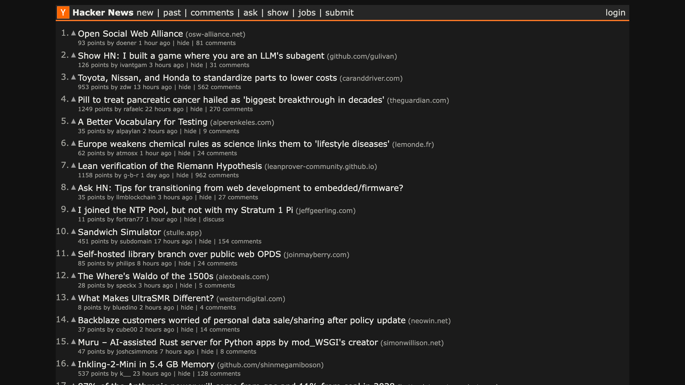

# darkhckr

Dark theme userscript for [Hacker News](https://news.ycombinator.com), tuned for comfortable, high-contrast reading.

- Off-white text on dark gray: titles 14.5:1, comments 12.5:1, meta 6.8:1, visited links 5.3:1 (all pass WCAG AA)
- Applied at `document-start`, so there is no white flash on load
- Downvoted comments still fade, toward the background, at about the same steps as stock HN
- Styles inputs, code blocks, the top bar, and the footer; native scrollbars and controls go dark too

## Install

1. Install a userscript manager: [Violentmonkey](https://violentmonkey.github.io/), [Tampermonkey](https://www.tampermonkey.net/), or [Userscripts](https://github.com/quoid/userscripts) for Safari.
2. Open [`hn-dark.user.js`](https://github.com/floatdrop/darkhckr/raw/main/hn-dark.user.js). Your manager will offer to install it.

## Options

At the top of the script:

- `FOLLOW_SYSTEM_THEME = true` turns the theme on only when your OS or browser is in dark mode.
- The `--hn-*` CSS variables hold every color, so you can tweak the palette in one place.
